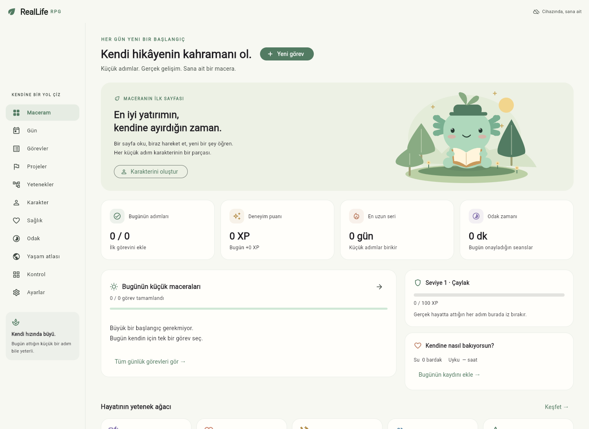

# RealLife RPG 🌱

**Oyun karakterine verdiğin emeği kendine de ver.** Görevlerini, alışkanlıklarını, öğrenme hedeflerini ve gerçek yaşam deneyimlerini sevimli bir hayat RPG’sinde biriktir.

Türkçe, kişiselleştirilebilir, öncelikle çevrimdışı Flutter uygulaması. Windows, macOS, Linux ve Android aynı kodu kullanır. Tarayıcı sürümü de yerel kayıt tutar. İlk açılışta kişisel veri ve tamamlanmış görev gelmez.



## İndirme

[Releases](https://github.com/kaansavukduran/reallife-rpg/releases) dört platformun derlemesi ve kontrolleri başarılı olduğunda oluşan paketleri içerir. [Actions](https://github.com/kaansavukduran/reallife-rpg/actions/workflows/release.yml) her platformun gerçek sonucunu gösterir.

| Platform | Paket | Kullanım |
| --- | --- | --- |
| Windows x64 | `RealLife-RPG-Windows-Kurulum.exe` / `RealLife-RPG-Windows-portable.zip` | Kur veya ZIP’ten `reallife_rpg.exe` çalıştır. |
| macOS | `RealLife-RPG-macOS.dmg` / ZIP | Applications’a sürükle. İlk açılışta sağ tık → Aç gerekebilir. |
| Linux x64 | `RealLife-RPG-linux-x64.tar.gz` | `./bundle/reallife_rpg` veya `./install.sh`. GTK 3 gerekir. |
| Android | `RealLife-RPG-Android-onizleme.apk` | APK’yı telefonda açıp yükle. |
| Tarayıcı | Actions → `web-preview` artifact | Bir statik HTTP sunucusunda çalıştır. |

Masaüstü paketleri kod imzası içermez. APK geliştirme anahtarıyla imzalı önizlemedir. CI bu anahtarı önbellekte tutar; önbellek silinirse imza değişebilir. Güncelleme öncesinde JSON yedeği al. Uygulamayı kaldırmak Android verilerini siler. Mağaza dağıtımı ve kalıcı imzalar henüz yapılandırılmadı.

## Özellikler

- **Maceram:** günlük ilerleme, XP, seri, odak süresi ve yaşam alanları. Özgün vektörel aksolotl; dokununca hareket eder.
- **Gün / alışkanlıklar:** her gün, hafta içi, seçili günler veya tek seferlik görev; başlangıç, not, zorluk, hatırlatma ve alt adımlar. Son alt adım görevi bitirir. Gelecek gün işaretlenemez.
- **Görevler / Kontrol:** sürükle sıralama, düzenle, sonlandır, yeniden başlat, onayla sil ve geri al; 7/14/30 günlük görev × gün tablosu ve geçmiş düzeltme. Tekrar kuralını değiştirmek eski günleri değiştirmez.
- **Karakter:** ad, hikâye, altı meslek yolu, dört fantastik sınıf, üç yol arkadaşı rengi, seviye, unvan, altın, statlar, 26 haftalık etkinlik haritası, 14 rozet. Meslek bir niyettir; yeterlilik belgesi değildir.
- **Görev tahtası:** günlük meydan okumalar, haftalık hedef ve mükemmel gün kutlaması.
- **Projeler:** hayat hedefleri oluştur; yeni/mevcut görevleri bağla, yaşam alanı seç, arşivle. Bağlantıyı kaldırmak görevi silmez.
- **Yetenekler:** görevleri Zihin, Beden, Meslek, Sosyal ve Denge alanlarına ayır. Yazılım, İngilizce ve araştırma okuryazarlığında beşer soruluk açıklamalı bilgi testleri; tarihli yanıt ve değerlendirme günlüğü.
- **AI değerlendirmesi:** isteğe bağlı servisle çalışma örneğini dört ölçüte göre değerlendir; gerekçe, kanıt alıntısı, belirsizlik ve sonraki adımları kaydet. Servis olmadan uydurma AI sonucu gösterilmez.
- **Sağlık:** günlere göre su, uyku, hareket, ruh hali ve not. Bilinmeyen uyku/hareket boş kalır; tıbbi değerlendirme yapılmaz.
- **Odak:** 5/15/25/45/60 dakikalık seans; duraklat/devam et/sıfırla ve görev bağlantısı. Sekmeler arasında sürer; süre bittiğinde sen onaylarsın, görev otomatik bitmez.
- **Yaşam atlası:** ülkeler, diller, kitaplar, sertifikalar, ilkler ve deneyimler için tarihli/notlu anılar. Kişisel beyan olarak tutulur.
- **Kişiselleştirme:** Sakin Bahçe dahil 7 tema; %80–%200 ölçek; işletim sisteminin metin boyutuna uyum; oyun modunu kapatma; telefon menüsü ve klavye kısayolları.
- **Yedekleme:** atomik masaüstü kayıt, son 14 günlük yedek, JSON dışa/içe aktarım ve içe aktarmadan önce mevcut veriyi koruma. Android’de sistem dosya seçicisi; web’de siteye özel yerel depolama ve dosya aktarımı.

Kısayollar: `Ctrl+N` yeni görev · `Alt+←/→` önceki/sonraki gün · `Alt+B` bugün · `Ctrl+1…5` temel sekmeler. Telefonlarda sol üst menü bütün ekranları açar.

## Önceki uygulamadan geçiş

[Günlük Görevler](https://github.com/kaansavukduran/gorevyonetimuygulamas-) görev motoru ve platform altyapısı korunmuştur. Orada JSON yedeği dışa aktar, burada **Ayarlar → Yedeği içe aktar**. Biçim 1/2 okunur; RPG kayıtlarını içeren biçim 3 yazılır. Eski uygulama yeni yedeği okuyamaz.

Yeni uygulamanın kimlikleri ve veri klasörleri ayrıdır; eski veriye otomatik dokunulmaz. Görev tarihleri ve işaret saatleri korunur. Görünüm ayarlarını yeniden seçebilirsin.

## Oyun kuralları ve ölçüm

XP yalnız tik geçmişinden hesaplanır: kolay 10, orta 20, zor 35 temel XP; kendi gününde +5; seri +2/gün, en çok +20; mükemmel gün +25. Sonradan işaretlenen gün yalnız temel XP alır. Seviye n → n+1: `100 + 40 × (n−1)` XP. İşareti kaldırmak veya görevi silmek puanları yeniden hesaplar.

Odak, sağlık, anı ve test kayıtları XP üretmez. Görev sayısı uzmanlık sayılmaz. Bilgi testleri küçük ve sabit başlangıç örneklemleridir; tekrar çözülürken cevapları öğrenilebilir. AI, doğruluk, akıl yürütme, uygulama ve sınırlılıklar boyutlarında 0–4 puan verir. Sunucu toplamı hesaplar ve alıntıların verilen metinde bulunduğunu doğrular. Bu kontrol teknik doğruluğu veya model tarafsızlığını garanti etmez. Sonuç yalnız sunulan çalışmayı kapsar; sertifika, CEFR veya kapsamlı yetkinlik ölçümü değildir.

## Kayıt

| Platform | Konum |
| --- | --- |
| Windows | `%APPDATA%\RealLifeRPG\gorevler.json` |
| macOS | Uygulama sandbox’ında `Library/Application Support/RealLifeRPG` |
| Linux | `$XDG_DATA_HOME/reallife_rpg` veya `~/.local/share/reallife_rpg` |
| Android | Uygulamaya özel `files` klasörü |
| Tarayıcı | Geçerli site adresinin `localStorage` alanı |

`REALLIFE_RPG_DIR` masaüstü veri klasörünü değiştirir. Görev ve RPG verileri tek yedektedir; görünüm ayarları ayrı `ayarlar.json` dosyasındadır. Bozuk veya daha yeni görev dosyasının üzerine yazılmaz. Tarayıcı site verileri silinirse kayıt kaybolur; JSON yedeği al.

Hatırlatmalar uygulama açıkken çalışır. Odak sayacı uygulama kapanınca sıfırlanır. Otomatik cihazlar arası senkronizasyon yoktur; JSON yedeğini taşıyabilirsin.

## Geliştirme

Flutter **3.47.9**, Dart **3.13.7**. Uygulama çalışma zamanında yalnız SDK paketlerini kullanır. AI sunucusu Python standart kütüphanesidir. Simge üretiminde geliştirme bağımlılığı Pillow’dur.

```sh
flutter pub get --enforce-lockfile
dart format --output=none --set-exit-if-changed lib test integration_test
flutter analyze
flutter test
python3 -m unittest discover -s server -v
flutter run -d chrome
flutter build web --release
flutter build apk --release
flutter build windows --release # Windows üzerinde
flutter build macos --release   # macOS üzerinde
flutter build linux --release
```

Linux derleme paketleri: `clang cmake ninja-build pkg-config libgtk-3-dev xvfb`. Gerçek kayıt/yeniden açılış: `xvfb-run -a flutter test integration_test/file_roundtrip_test.dart -d linux`. Android özel depolama: `flutter test integration_test/android_device_test.dart -d <cihaz>`.

### İsteğe bağlı AI servisi

Sağlayıcı anahtarı uygulamaya gömülmez ve repoya yazılmaz. Kendi makinenin ortam değişkeni / secret yöneticisiyle sunucuya ver:

```sh
# OPENAI_API_KEY ortamda tanımlı olmalı.
python3 server/assessment_server.py
# İkinci terminal, masaüstü:
flutter run -d linux --dart-define=AI_API_URL=http://127.0.0.1:8787/assess
```

`OPENAI_MODEL`: varsayılan `gpt-4.1-mini`. `AI_PORT`: varsayılan `8787`. Servis yalnız `127.0.0.1` dinler. Sağlayıcı kullanımı ücret doğurabilir. Eşzamanlılık, saatlik istek ve metin boyutu sınırlıdır. Uzak/üretim Android bağlantısı için kimlik doğrulamalı HTTPS ağ geçidi gerekir; geliştirme servisini doğrudan internete açma. Dağıtım APK’sında HTTPS kullan.

Yalnız **AI ile değerlendir** eylemi çalışma metnini ve beceri kimliğini servise, oradan OpenAI’a gönderir. Görevler, profil, sağlık ve atlas gönderilmez. AI adresi verilmemiş derlemelerde özellik kapalıdır; çevrimdışı testler çalışır. Canlı model kalitesi anahtarsız testler tarafından doğrulanmaz.

## Kapsam

0.1 çalışan bir başlangıç sürümüdür. Adaptif/geniş soru bankası, başka konularda otomatik değerlendirme oluşturma, uzman incelemesi, hesap/şifreli senkronizasyon, kapalıyken bildirim, kalıcı imzalar ve mağaza yayınları henüz yoktur.

`lib/src/domain/`: görev/tekrar/oyun/RPG ve veri biçimi. `app/`: kayıt denetleyicisi ve odak saati. `storage/`: masaüstü/Android/web. `ui/`: ekranlar ve özgün Canvas çizimi. `server/`: AI servisi. [Özellik eşlemesi](docs/FEATURES.md).
