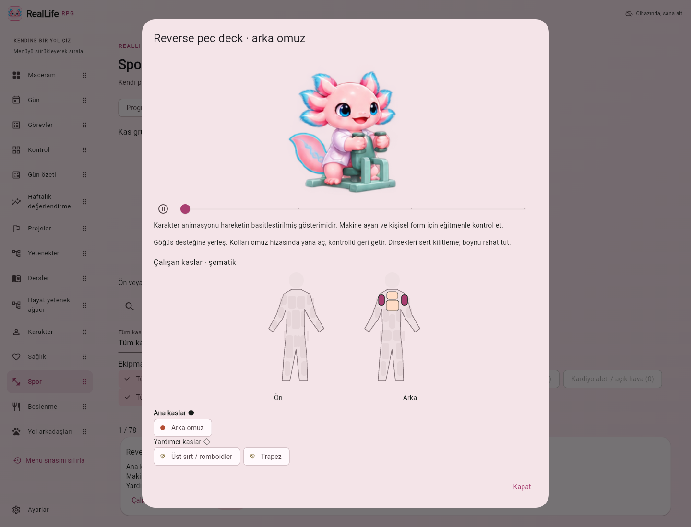

# RealLife RPG 🌱

Et seçiminde altı ana ailenin 1.976 varyantı kısa Türkçe/İngilizce ad, ayrı yağ/deri/kemik/hazırlama özellikleri ve NDB koduyla görünür. Tam kaynak açıklaması açılabilir; eski öğünlerin özgün adları ve besin değerleri korunur. Diğer kaynak adlarının Türkçeleştirilmesi sürüyor.

**Oyun karakterine verdiğin emeği kendine de ver.** Görevlerini, alışkanlıklarını, öğrenme hedeflerini ve gerçek yaşam deneyimlerini sevimli bir hayat RPG’sinde biriktir.

Yeni spor/beslenme/karakter akışları Türkçe ve İngilizce, kişiselleştirilebilir, öncelikle çevrimdışı Flutter uygulaması. Windows, macOS, Linux ve Android aynı kodu kullanır. Tarayıcı sürümü de yerel kayıt tutar. İlk açılışta kişisel veri ve tamamlanmış görev gelmez.



[Sürüklemeli ölçek](docs/screenshots/interface-scale-slider.png) · [Renk seçici](docs/screenshots/color-picker.png) · [Özel tema ayarları](docs/screenshots/custom-theme-desktop.png)

## İndirme

**[En son sürümü indir · Latest](https://github.com/kaansavukduran/reallife-rpg/releases/latest)**

[Releases](https://github.com/kaansavukduran/reallife-rpg/releases) dört platformun derlemesi ve kontrolleri başarılı olduğunda oluşan paketleri içerir. [Actions](https://github.com/kaansavukduran/reallife-rpg/actions/workflows/release.yml) her platformun gerçek sonucunu gösterir.

| Platform | Paket | Kullanım |
| --- | --- | --- |
| Windows x64 | `RealLife-RPG-<sürüm>-Windows-Kurulum.exe` / portable ZIP | Kur veya ZIP’ten `reallife_rpg.exe` çalıştır. |
| macOS | `RealLife-RPG-<sürüm>-macOS.dmg` / ZIP | Applications’a sürükle. İlk açılışta sağ tık → Aç gerekebilir. |
| Linux x64 | `RealLife-RPG-<sürüm>-linux-x64.tar.gz` | `./bundle/reallife_rpg` veya `./install.sh`. GTK 3 gerekir. |
| Android | `RealLife-RPG-<sürüm>-Android-onizleme.apk` | APK’yı telefonda açıp yükle. |
| Tarayıcı | GitHub Pages (tek seferlik hesap ayarı gerekiyor) / Actions → `web-preview` | Telefonda bağlantıyı aç; paket kurulmaz. |

Masaüstü paketleri kod imzası içermez. APK geliştirme anahtarıyla imzalı önizlemedir. CI bu anahtarı önbellekte tutar; önbellek silinirse imza değişebilir. Güncelleme öncesinde JSON yedeği al. Uygulamayı kaldırmak Android verilerini siler. Mağaza dağıtımı ve kalıcı imzalar henüz yapılandırılmadı.

## Özellikler

Sol menü masaüstünde fareyle, telefonda basılı tutarak sıralanır. Klavye ile odaklanan öğeyi `Ctrl+↑/↓` taşır. Sıra bu cihazda kaydedilir; yalnız menü sırasını sıfırlama düğmesi vardır. Ayarlar altta sabittir. Odak ve Yaşam atlası menü seçenekleri kaldırılmıştır; eski kayıtlar/yedek alanları korunur.

- **Maceram:** günlük ilerleme, XP, seri, odak süresi ve yaşam alanları. Aion varsayılan yol arkadaşıdır. Baş/gövde/kuyruk/ayak dokunuşuna farklı tepki; uygulama boyunca çizilmiş yön kareleriyle fareyi takip. Azaltılmış hareket seçimi korunur.
- **Gün / alışkanlıklar:** her gün, hafta içi, seçili günler veya tek seferlik görev; başlangıç, not, sürüklemeli 0–100 temel XP, saat/süre aralığı, hatırlatma ve alt adımlar. Son alt adım görevi bitirir. Hızlı eklemedeki saat düğmesinden veya editörden klavyeyle 24 saat biçiminde saat girilebilir. Sağda Yapıldı 👍 vardır; sol tarafta Yapılamadı düğmesi yoktur. Saat/süre geçince yapılmayan dinamik olarak görünür; bugün veya geçmiş gün sonradan işaretlenebilir. Gelecek gün işaretlenemez.
- **Görevler / Kontrol:** Görevler kartının sağından seçilen güne doğrudan Yapıldı tiki; üstte görünür tik tarihiyle geçmiş gün düzeltmesi. Gün ve Görevler ekranında kartı fareyle tutup yukarı/aşağı sürükleme (telefonda uzun basma), kalıcı manuel sıralama, isteğe bağlı saate göre sıralama, düzenle, sonlandır, yeniden başlat, onayla sil ve geri al; 7/14/30 günlük görev × gün tablosu ve geçmiş düzeltme. Tekrar kuralını değiştirmek eski günleri değiştirmez.
- **Karakter:** ad, hikâye, altı meslek yolu, dört fantastik sınıf, dört seçilebilir yol arkadaşı, seviye, unvan, altın, statlar, 26 haftalık etkinlik haritası, 14 rozet. Meslek bir niyettir; yeterlilik belgesi değildir.
- **Görev tahtası:** günlük meydan okumalar, haftalık hedef ve mükemmel gün kutlaması.
- **Projeler:** hayat hedefleri oluştur; yeni/mevcut görevleri bağla, yaşam alanı seç, arşivle. Bağlantıyı kaldırmak görevi silmez.
- **Yetenekler:** görevleri Zihin, Beden, Meslek, Sosyal ve Denge alanlarına ayır. Yazılım, İngilizce ve araştırma okuryazarlığında beşer soruluk açıklamalı bilgi testleri; tarihli yanıt ve değerlendirme günlüğü.
- **AI değerlendirmesi:** isteğe bağlı servisle çalışma örneğini dört ölçüte göre değerlendir; gerekçe, kanıt alıntısı, belirsizlik ve sonraki adımları kaydet. Servis olmadan uydurma AI sonucu gösterilmez.
- **Sağlık:** günlere göre su, uyku, hareket, ruh hali ve not. Bilinmeyen uyku/hareket boş kalır; tıbbi değerlendirme yapılmaz.
- **Kişiselleştirme:** Sakin Bahçe dahil 7 hazır tema; vurgu/ikinci vurgu/arka plan/kart renkleri için sürüklenebilir renk alanı, ton-doygunluk-parlaklık kaydırıcıları, HEX girişi, hazır renkler, canlı önizleme ve ayrı ayrı sıfırlama; 4–32 px köşe yuvarlaklığı, sistem/serif/kod yazı stili, sıkı denetimler, animasyon azaltma; %80–%200 arasında sağa/sola sürüklemeli ölçek çubuğu, %5 çubuk adımı, doğrudan tam yüzde girişi ve %100 sıfırlama; sürüklerken canlı boyut önizlemesi, bırakınca tüm arayüze uygulama; işletim sisteminin metin boyutuna uyum; oyun modunu kapatma; telefon menüsü ve klavye kısayolları.
- **Yedekleme:** atomik masaüstü kayıt, son 14 günlük yedek, JSON dışa/içe aktarım ve içe aktarmadan önce mevcut veriyi koruma. Android’de sistem dosya seçicisi; web’de siteye özel yerel depolama ve dosya aktarımı.

Kısayollar: `Ctrl+N` yeni görev · `Alt+←/→` önceki/sonraki gün · `Alt+B` bugün · `Ctrl+1…5` temel sekmeler. Telefonlarda sol üst menü bütün ekranları açar.

## Spor, Besin Matriksi ve yol arkadaşları

- **Spor → Hareket kütüphanesi:** 78 hareket; tıklanabilir kas haritası ve çoklu ekipman filtresi, TR/EN arama. Reverse pec deck, chest/shoulder press, leg press, seated/lying leg curl, leg extension, hip abduction/adduction, kablo/dambıl/barbell/vücut ağırlığı hareketleri ve sekiz kardiyo türü. Ana/yardımcı kaslar ön/arka şemada ve metinde gösterilir. Kendi hareketini ekleyebilir, kaslarını ve animasyon ailesini seçebilirsin.
- **Yol arkadaşları:** referanslarına göre Aion, Blessed Ignorant Sheep, Accursed Wise Wolf ve Baykuş Ömer. Seçim spor, beslenme, karakter ve macera ekranlarında korunur. Karakterler tam gövdeli PNG atlaslarının ardışık kareleriyle oynar. Aion hazır Pet kaynağını, diğerleri kendi cartoon atlaslarını kullanır; okuma, yaban mersini yeme, tepki ve yönlere bakış vardır. Duraklat/oynat/kare çubuğu ve azaltılmış hareket korunur. Dambıl curl, makine reverse pec deck, göğüs pres makinesi (`chest_press` + makine), halterle bench press (`bench_press` + halter) ve eğimli dambıl pres (`incline_press` + dambıl) kareleri hazırdır; üç pres klibinde dört karakterin her biri sekiz ayrı kareyle oynar. Bench press sırtüstü düz bankta, eğimli pres iki ayrı dambıl ve eğimli sırt desteğiyle çizilmiştir. Önizleme şeridi yalnız hazır klipleri gösterir; kardiyo kütüphanesi ve programları korunur. Diğer preslere bu kareler atanmaz; diğer hareket/ekipman eşleşmelerinin özel kareleri açıkça bekliyor olarak gösterilir. Çizimler basitleştirilmiş gösterimdir; profesyonel 3D teknik eğitim veya tüm olası egzersizlerin eksiksiz listesi değildir.
- **Spor → Programlarım:** boş program veya isteğe bağlı alt/üst örneği; günler, hareket sırası, set×tekrar, kg ve dinlenme elle düzenlenir. Yeni kuvvet hareketi 3×12 başlar; set ve tekrarın altında ayrı azalt/artır düğmeleri bulunur. Kütüphaneden seçilen hareket ayarlanıp mevcut veya yeni program/güne eklenebilir. Kopyalama ve silme var. İlk açılışta program veya yapılmış antrenman gelmez. Örnek eklemek geçmiş/XP üretmez.
- **Yaptığımı kaydet:** yalnız işaretlenen gerçek setler, gerçek tekrar/yük ve süre. Kardiyoda yürüyüş, koşu bandı, bisiklet, Air Walk, eliptik, kürek, merdiven veya koşu; süre, hız, eğim ve manuel MET. İsteğe bağlı vücut kg bilinmiyorsa kalori bilinmiyor kalır. Yürüyüşte uygun hız/eğim varsa ACSM denklemi; diğerlerinde açıkça manuel MET tahmini. Brüt kcal dinlenme enerjisini içerir. Ağırlık ve program değişikliği eski kaydı değiştirmez.
- **Beslenme:** SHA-256 ile doğrulanmış resmî USDA SR28 arşivinden 8.789 besin ve 20 bileşen; çiğ/pişmiş ayrı. Seçici kategori → besin → biçim olarak ilerler; kategori içinde arama, geri dönüş ve biçim filtreleri vardır. Kaynak ayrıntısı ayrıca açılır. Gram kaydırıcısı, hassas g/kg seçimi, sınırsız öğün birleşimi, günlük/seçili hafta günleri için öğün programı. Bugün/geçmiş güne yeni elle eklenen besin yendi kabul edilir; öğün listesindeki tik değiştirilebilir. Gelecek kayıtlar ve otomatik programlar plan kalır. Elle besin/hedef, günlük matriks ve haftalık toplam. Türkçe olmayan kaynak adları İngilizce kalır; yaygın Türkçe arama eşleşmeleri eklenmiştir. Eksik değer “—”, gerçek sıfır “0”; toplam bilinen değerleri ve kapsamı gösterir. Kayıt silme geri alınabilir. Gün özeti günlük/haftalık besin − brüt egzersiz kaydı aritmetiğini, eksik veri kapsamıyla gösterir; bu gerçek günlük enerji ihtiyacı veya ölçülmüş kalori açığı değildir. Besin ve sağlık kayıtları XP vermez.
- **Ayarlar:** yan menü ve telefon çekmecesinin en altında sabittir. Cihaz dili veya kalıcı TR/EN; bağımsız yazı boyutu, sistem/serif/mono/OpenDyslexic, açık/koyu/sistem/yüksek kontrast seçenekleri, satır/harf aralığı. OpenDyslexic'in özgün OTF dosyaları, Türkçe harf kapsamı ve OFL bildirimi korunur. %200 arayüz ölçeği dar ekranda düşürülmez; gerekirse yatay kaydır. Eski görev/sağlık/atlas ekranlarının İngilizce dönüşümü henüz tamamlanmadı.

Et seçicisinde altı ana aileden sonra parça/ürün adımı vardır: kıyma, bonfile, but, kaburga ve diğer 30 Türkçe/İngilizce gezinme grubu. Parça adları iki dilde aranabilir. Ayrı USDA varyantlarının tam açıklamaları, kimlikleri ve değerleri korunur; çiğ/pişmiş filtreleri parça seçildikten sonra açılır.

Kaynak ve lisanslar [docs/sources](docs/sources) ile uygulamanın **Beslenme → Kaynak** bölümünde. Ham özel program, Drive bağlantısı veya kişisel sağlık verisi dağıtıma gömülmez. Besin Matriksi'nin bütün tarif/karşılaştırma/ileri bileşen araçları bu ilk entegrasyona taşınmış değildir.

- **Dersler:** ders adı, 1–200 ünite, isteğe bağlı ünite adları ve gerçek işaretlerle ünite ilerlemesi. Ders ve spor günü programı seçili hafta günlerinde saat/isteğe bağlı süreyle mevcut Günlük Görevler listesine bağlanır. Takvim değişikliği yinelenen ikinci görev üretmez, eski tikleri korur.
- **Hayat / pasif yetenek ağaçları:** kullanıcı kök ve ana dal seçer; ağaç sürüklenip yakınlaştırılır, klavye için liste görünümü vardır. Hayat düğümü kişisel işarettir; pasif düğüm alan seviyesi ve önceki dal gerektirir. Alan seviyesi gerçek görevlerin temel XP’sinde her 100 XP’de bir artar. Bu oyun ilerlemesidir, insan becerisi sertifikası değildir.
- **Haftalık değerlendirme:** tüm görevler/spor/ders için 0–10 gerçek tamamlama oranı; gelecek ve henüz süresi dolmamış görevler dışarıda. On bantta üçer destekleyici mesaj; rastgele olan mesajdır, puan değildir. Seçili karakterin mutlu/nötr/düşünceli yüzü değişir; besin/kilo puanlanmaz.
- **Sağlık ve görünüm:** boy/kg, isteğe bağlı yetişkin BKİ referansı; Aion pembe/mavi varsayılan tema/logo, ayrı uygulama içi logo seçimi, mevcut Yazı stili içinde OpenDyslexic. Kurulum simgesi Aion kalır; uygulama içi simge dört karakterden seçilebilir.

Her animasyon tam gövdeli resim hücrelerini sabit kadrajda sırayla gösterir. [Göğüs presi başlangıç/itiş kareleri](docs/screenshots/chest-press-frames.png) · [Tam gövde etkinlikleri](docs/screenshots/full-body-activities.png). Hareket çizimleri basitleştirilmiştir; uzman teknik onayı değildir.

## Telefondan web önizlemesi

Hesap sahibi bir kez **repo → Settings → Pages → Build and deployment → Source: GitHub Actions** seçer. Bağlı GitHub uygulaması bu hesap ayarını açarken 403 verdi; kod bunu atlamaz. Bu seçimden sonra **Actions → release → Run workflow → main** ile başlat. Dört platform ve web kontrolleri geçince `pages` işi aşağıdaki adresi yayımlar:

https://kaansavukduran.github.io/reallife-rpg/

Bu adres ayar açılmadan canlı yayın sayılmaz. Sonraki kod push'ları aynı kontrollerden geçip web sürümünü günceller. Telefonda bağlantıyı açmak yeterli; kişisel kayıt bu tarayıcının `localStorage` alanında kalır. Başka adres/cihaza taşımak için önce Ayarlar’dan JSON yedeği al. Yerel geliştirmede `flutter run -d windows` veya `flutter run -d chrome`, terminalde `r` hot reload; ilk çalıştırmada geliştirme derlemesi yapılır.

## Önceki uygulamadan geçiş

[Günlük Görevler](https://github.com/kaansavukduran/gorevyonetimuygulamas-) görev motoru ve platform altyapısı korunmuştur. Orada JSON yedeği dışa aktar, burada **Ayarlar → Yedeği içe aktar**. Biçim 1–5 okunur; dersler, program bağları, öğün şablonları, ağaçlar ve 0–100 görev XP’sini içeren biçim 6 / life 4 yazılır. Eski uygulama yeni yedeği okuyamaz.

Yeni uygulamanın kimlikleri ve veri klasörleri ayrıdır; eski veriye otomatik dokunulmaz. Görev tarihleri ve işaret saatleri korunur. Görünüm ayarlarını yeniden seçebilirsin.

## Oyun kuralları ve ölçüm

XP yalnız tik geçmişinden hesaplanır: kaydırıcıyla 0–100 temel XP; eski kolay/orta/zor değerleri 10/20/35 korunur. Temel ödül işaret anında saklanır; sonradan XP ayarı değiştirmek geçmiş ödülü değiştirmez. 0 XP görev kendi ödülünü kapatır ve tüm görevleri 0 XP olan güne mükemmel gün XP’si verilmez. Diğer görevlerde: kendi gününde +5; seri +2/gün, en çok +20; mükemmel gün +25. Sonradan işaretlenen gün yalnız temel XP alır. Seviye n → n+1: `100 + 40 × (n−1)` XP. İşareti kaldırmak veya görevi silmek puanları yeniden hesaplar.

Odak, sağlık, anı ve test kayıtları XP üretmez. Görev sayısı uzmanlık sayılmaz. Bilgi testleri küçük ve sabit başlangıç örneklemleridir; tekrar çözülürken cevapları öğrenilebilir. AI, doğruluk, akıl yürütme, uygulama ve sınırlılıklar boyutlarında 0–4 puan verir. Sunucu toplamı hesaplar ve alıntıların verilen metinde bulunduğunu doğrular. Bu kontrol teknik doğruluğu veya model tarafsızlığını garanti etmez. Sonuç yalnız sunulan çalışmayı kapsar; sertifika, CEFR veya kapsamlı yetkinlik ölçümü değildir.

## Kayıt

| Platform | Konum |
| --- | --- |
| Windows | `%APPDATA%\RealLifeRPG\gorevler.json` |
| macOS | Uygulama sandbox’ında `Library/Application Support/RealLifeRPG` |
| Linux | `$XDG_DATA_HOME/reallife_rpg` veya `~/.local/share/reallife_rpg` |
| Android | Uygulamaya özel `files` klasörü |
| Tarayıcı | Geçerli site adresinin `localStorage` alanı |

`REALLIFE_RPG_DIR` masaüstü veri klasörünü değiştirir. Görev ve RPG verileri tek yedektedir; görünüm ayarları ayrı `ayarlar.json` dosyasındadır. Bozuk veya daha yeni görev dosyasının üzerine yazılmaz. Tarayıcı site verileri silinirse kayıt kaybolur; JSON yedeği al.

Hatırlatmalar uygulama açıkken çalışır. Odak sayacı uygulama kapanınca sıfırlanır. Otomatik cihazlar arası senkronizasyon yoktur; JSON yedeğini taşıyabilirsin.

## Geliştirme

Flutter **3.47.9**, Dart **3.13.7**. Uygulama çalışma zamanında yalnız SDK paketlerini kullanır. AI sunucusu Python standart kütüphanesidir. Simge üretiminde geliştirme bağımlılığı Pillow’dur.

```sh
flutter pub get --enforce-lockfile
dart format --output=none --set-exit-if-changed lib test integration_test
flutter analyze
flutter test
python3 -m unittest discover -s server -v
# İsteğe bağlı tarayıcı testi: Playwright + Chromium kuruluysa
# build/web bir HTTP sunucusunda açıkken: node tool/browser_smoke.cjs
flutter run -d chrome
flutter build web --release
flutter build apk --release
flutter build windows --release # Windows üzerinde
flutter build macos --release   # macOS üzerinde
flutter build linux --release
```

Linux derleme paketleri: `clang cmake ninja-build pkg-config libgtk-3-dev xvfb`. Gerçek kayıt/yeniden açılış: `xvfb-run -a flutter test integration_test/file_roundtrip_test.dart -d linux`. Android özel depolama: `flutter test integration_test/android_device_test.dart -d <cihaz>`.

### İsteğe bağlı AI servisi

Sağlayıcı anahtarı uygulamaya gömülmez ve repoya yazılmaz. Kendi makinenin ortam değişkeni / secret yöneticisiyle sunucuya ver:

```sh
# OPENAI_API_KEY ortamda tanımlı olmalı.
python3 server/assessment_server.py
# İkinci terminal, masaüstü:
flutter run -d linux --dart-define=AI_API_URL=http://127.0.0.1:8787/assess
```

`OPENAI_MODEL`: varsayılan `gpt-4.1-mini`. `AI_PORT`: varsayılan `8787`. Servis yalnız `127.0.0.1` dinler. Sağlayıcı kullanımı ücret doğurabilir. Eşzamanlılık, saatlik istek ve metin boyutu sınırlıdır. Uzak/üretim Android bağlantısı için kimlik doğrulamalı HTTPS ağ geçidi gerekir; geliştirme servisini doğrudan internete açma. Dağıtım APK’sında HTTPS kullan.

Yalnız **AI ile değerlendir** eylemi çalışma metnini ve beceri kimliğini servise, oradan OpenAI’a gönderir. Görevler, profil, sağlık ve atlas gönderilmez. AI adresi verilmemiş derlemelerde özellik kapalıdır; çevrimdışı testler çalışır. Canlı model kalitesi anahtarsız testler tarafından doğrulanmaz.

## Kapsam

0.1 çalışan bir başlangıç sürümüdür. Adaptif/geniş soru bankası, başka konularda otomatik değerlendirme oluşturma, uzman incelemesi, hesap/şifreli senkronizasyon, kapalıyken bildirim, imza doğrulayan uygulama içi güncelleyici, Linux AppImage/deb, kalıcı imzalar ve mağaza yayınları henüz yoktur.

`lib/src/domain/`: görev/tekrar/oyun/RPG ve veri biçimi. `app/`: kayıt denetleyicisi ve odak saati. `storage/`: masaüstü/Android/web. `ui/`: ekranlar ve özgün Canvas çizimi. `server/`: AI servisi. [Özellik eşlemesi](docs/FEATURES.md).

## Forge geliştirme döngüsü

Bu repo için saatlik Forge geliştirme akışı kuruludur. Güncel kabul ölçütleri, kuyruk, çalışma kilidi ve bir sonraki iş [FORGE.md](FORGE.md), doğrulanmış tur sonuçları [Forge günlüğünde](docs/FORGE_LOG.md) tutulur. Her tur kaldığı yerden somut geliştirme, test ve platform derlemesiyle ilerler. Planlanmış tur tamamlanmış iş sayılmaz; kullanıcı/anahtar/gerçek cihaz gerektiren engeller açık kalır. Diğer projelerin otomasyonları ayrıdır.

Şınav önizlemesi dört özgün karakter paftasına göre ayrı atlaslar kullanır. Baykuş kanatlarıyla çizgi film uyarlaması yapar; bu bir teknik form sertifikası değildir.

Pec deck göğüs açış da dört özgün karakter paftasına göre ayrı sekizer kareyle oynar; kollar/kanatlar göğüs önünde birleşir. Makine eşleşmesi açık seçilir, diğer ekipmana bu klip atanmaz.

Kablo göğüs açış: dört karakterin özgün paftalarına dayalı ayrı 4×2 atlaslar (32 kare). Yalnız cable_fly/kablo eşleşmesinde, önizleme ve Spor ayrıntısında oynar; pedli makine klibiyle karışmaz. Kablo tutacakları göğüs önünde birleşir; baykuş kanatları çizgi film uyarlamasıdır.

Dambıl ters açış: dört karakter için özgün paftalardan üretilen ayrı sekizer kare (32). Oturarak öne eğilme varyantı, iki ayrı dambıl ve yalnız reverse_dumbbell_fly/dambıl eşleşmesi; makine reverse pec deck ayrı kalır. TR/EN açıklama, önizleme, normal Spor ekranı ve kare kontrolleri birlikte çalışır. Eksik veya yanlış ekipmanda eski makine resmi yerine boşta kareleri gösterilir.

Kablo face pull: dört özgün karakter paftasına göre ayrı sekizer kare (32). Tek yüksek makara ve iki uçlu ip yüzün iki yanına çekilir; yalnız face_pull/kablo eşleşmesi. Makine/dambıl ters açış klipleri ayrıdır; yanlış ekipman veya eksik atlas boşta görünür. TR/EN açıklama, önizleme, normal Spor ekranı ve kare kontrolleri ortak kareleri kullanır.

Makinede omuz pres: dört özgün karakter paftasına göre ayrı sekizer kare (32). Dik sırt desteği ve sabit ayaklarla iki makine tutacağı omuz hizasından baş üzerine itilir; yalnız shoulder_press/makine eşleşmesi. Göğüs pres ve diğer omuz pres ekipmanları ayrı kalır. Önizleme, normal Spor ekranı, TR/EN açıklama, kare çubuğu ve azaltılmış hareket desteklenir. Baykuş kanatlarıyla çizgi film uyarlamasıdır.

Dambıl omuz pres: dört özgün karakter paftasına göre ayrı sekizer tam gövde kare (32). Dik sırt desteği ve iki bağımsız dambıl; yalnız shoulder_dumbbell/dambıl eşleşmesi. Makine ve eğimli göğüs pres kareleri ayrı kalır. Baykuş tüylü kanat uçları ve kavrama kayışlarıyla çizgi film uyarlamasıdır. TR/EN açıklama, normal Spor ekranı, önizleme, kare çubuğu ve azaltılmış hareket korunur.
